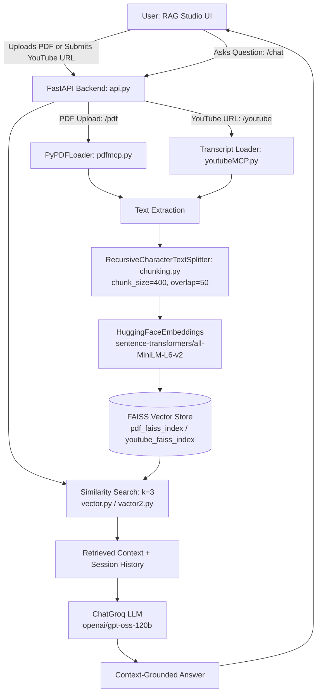
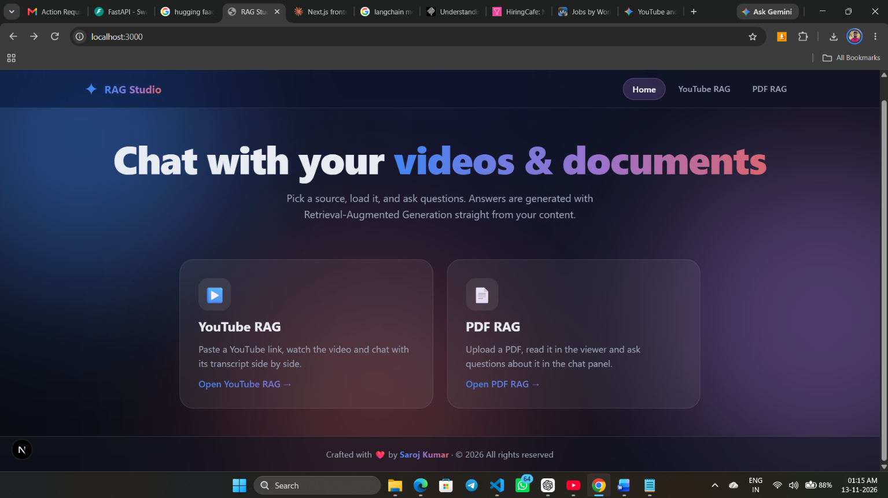
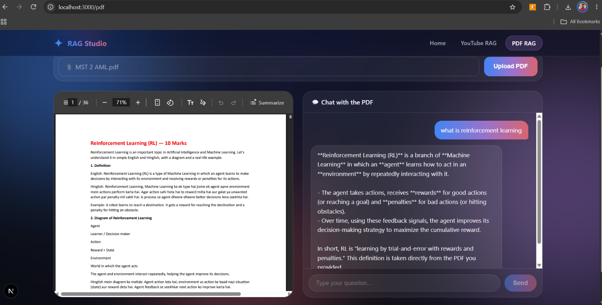
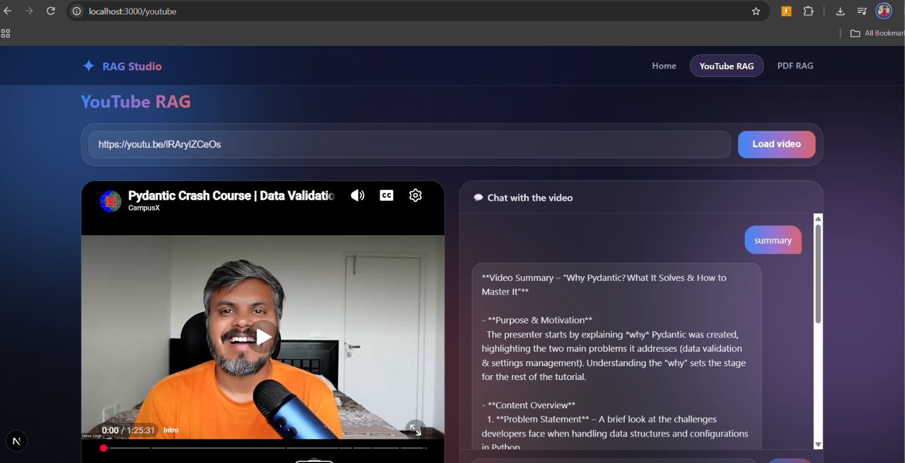

# YouTube & PDF RAG Assistant (RAG Studio) – AI-Powered Document and Video Question Answering System

An AI-powered **Retrieval-Augmented Generation (RAG)** application (**RAG Studio**) that lets users query **PDF documents** and **YouTube videos** using natural language. Instead of reading lengthy PDFs or watching entire videos, users can upload a PDF or load a YouTube URL side by side with an interactive AI chat panel powered by session-aware conversational memory.

## Table of Contents

* [Overview](#overview)
* [Core Features](#core-features)
* [Architecture & Workflow](#architecture--workflow)
* [Technology Stack](#technology-stack)
* [Project Structure](#project-structure)
* [Installation Guide (Windows & Git Bash)](#installation-guide-windows--git-bash)
* [Environment Variables](#environment-variables)
* [Running the Application](#running-the-application)
* [API Endpoints](#api-endpoints)
* [Screenshots](#screenshots)
* [Demo](#demo)
* [Troubleshooting](#troubleshooting)

## Overview

The **YouTube & PDF RAG Assistant** combines document loading, video transcript extraction, recursive text chunking, local Hugging Face vector embeddings, FAISS similarity search, and Groq-hosted LLM inference (`ChatGroq`) behind a FastAPI REST backend connected to a Next.js frontend (`http://localhost:3000`).

## Core Features

1. **PDF Question Answering (`POST /pdf` & `POST /chat`)**
   * Accepts `.pdf` file uploads via FastAPI and stores them in the `uploads/` directory under a unique UUID `session_id`.
   * Displays the uploaded PDF in an interactive built-in viewer alongside the **Chat with the PDF** panel (`http://localhost:3000/pdf`).
   * Extracts text across all pages using `PyPDFLoader` (`pdfmcp.py`), splits it into overlapping chunks, and builds a local FAISS vector index (`pdf_faiss_index`).

2. **YouTube Video Question Answering (`POST /youtube` & `POST /chat`)**
   * Registers a validated YouTube video URL (`HttpUrl`) under a unique `session_id` and embeds the video player alongside the **Chat with the video** panel.
   * Extracts video transcripts via `youtubeMCP` (`transcript`) and indexes chunks into a local FAISS store (`youtube_faiss_index`).

3. **Session-Based Conversational RAG**
   * Maintains separate in-memory conversation histories (`chat_histories[session_id]`) in `main.py` and `main2.py` so users can ask contextual follow-up questions.
   * Grounds responses strictly in the top-`k` (`k=3`) retrieved chunks, instructing the LLM to state when an answer is not present in the retrieved context.

4. **FastAPI Backend with CORS Support**
   * Exposes clean REST endpoints (`/`, `/youtube`, `/pdf`, `/chat`) with CORS configured for `http://localhost:3000`.

## Architecture & Workflow



## Technology Stack

* **Language:** Python 3.12
* **Backend Framework:** FastAPI, Uvicorn, Pydantic
* **LLM Orchestration:** LangChain (`langchain-core`, `langchain-community`, `langchain-text-splitters`)
* **LLM Provider:** Groq (`langchain-groq` using `openai/gpt-oss-120b`)
* **Embeddings:** Hugging Face (`langchain-huggingface`, `sentence-transformers/all-MiniLM-L6-v2`)
* **Vector Store:** FAISS (`faiss-cpu`)
* **Document & Video Loaders:** `pypdf` (`PyPDFLoader`), `youtube-transcript-api`, `pytube`
* **MCP & Agent Dependencies:** `mcp`, `fastmcp`, `langchain-mcp-adapters`, `langgraph`
* **Frontend:** Next.js (`rag-frontend` running on `http://localhost:3000`)

## Project Structure

```text
yt_pdf_rag/
├── api.py                  # FastAPI server, CORS middleware, session management, and REST endpoints
├── main.py                 # YouTube RAG pipeline & per-session ChatGroq conversation history
├── main2.py                # PDF RAG pipeline & per-session ChatGroq conversation history
├── chunking.py             # RecursiveCharacterTextSplitter configuration (chunk_size=400, overlap=50)
├── vector.py               # YouTube transcript embedding, FAISS indexing (youtube_faiss_index), and k=3 search
├── vactor2.py              # PDF text embedding, FAISS indexing (pdf_faiss_index), and k=3 search
├── pdfmcp.py               # PDF text extraction helper using PyPDFLoader
├── youtubeMCP.py           # YouTube transcript extraction module (imported by vector.py)
├── req.txt                 # Python dependencies
├── uploads/                # Auto-created directory storing uploaded PDFs by session UUID
├── rag-frontend/           # Next.js frontend application (RAG Studio UI on port 3000)
└── assets/
    └── screenshots/        # Application UI screenshots
```

## Installation Guide (Windows & Git Bash)

### 1. Clone the Repository

Open **Git Bash** and run:

```bash
git clone https://github.com/silintsarojkumar/yt_pdf_rag.git
cd yt_pdf_rag
```

### 2. Create and Activate a Virtual Environment

```bash
python -m venv .venv
source .venv/Scripts/activate
```

*(In Windows Command Prompt, activate with `.venv\Scripts\activate.bat`; in PowerShell, use `.venv\Scripts\Activate.ps1`.)*

### 3. Install Python Dependencies

```bash
pip install --upgrade pip
pip install -r req.txt
```

## Environment Variables

`main.py`, `main2.py`, `vector.py`, and `vactor2.py` load environment variables via `python-dotenv` (`load_dotenv()`). Create a `.env` file in the project root before starting the server.

### `.env.example`

```env
# Required for ChatGroq LLM inference (main.py & main2.py)
GROQ_API_KEY=your_groq_api_key_here

# Optional: Recommended to avoid Hugging Face Hub rate limits when downloading sentence-transformers/all-MiniLM-L6-v2
HUGGINGFACEHUB_API_TOKEN=your_huggingface_token_here
```

Create your local `.env` file in Git Bash:

```bash
cp .env.example .env
```

Then open `.env` and replace the placeholder values with your actual keys. **Never commit `.env` to version control.**

## Running the Application

### 1. Start the Backend API Server (FastAPI)

Launch the backend directly via `api.py` or with `uvicorn`:

```bash
python api.py
```

*or:*

```bash
uvicorn api:app --host 127.0.0.1 --port 8000 --reload
```

* The API server runs at: `http://127.0.0.1:8000`
* Interactive Swagger API docs are available at: `http://127.0.0.1:8000/docs`

### 2. Start the Frontend Application (`rag-frontend`)

Open a second terminal to launch the **RAG Studio** Next.js interface:

```bash
cd rag-frontend
npm install
npm run dev
```

* Open `http://localhost:3000` in your browser.

### 3. Using PDF & YouTube Question Answering

* **Via RAG Studio UI (`http://localhost:3000`):**
  * Click **Open PDF RAG** (`/pdf`), select a `.pdf` file, click **Upload PDF**, and ask questions in the **Chat with the PDF** panel.
  * Click **Open YouTube RAG**, paste a YouTube video link, click **Load video**, and ask questions in the **Chat with the video** panel.

* **Via REST API (`http://127.0.0.1:8000/docs`):**
  1. Register a YouTube URL (`POST /youtube` with `{"url": "https://youtu.be/..."}`) or upload a PDF (`POST /pdf` with form-data `file`) to get a `session_id`.
  2. Query the source via `POST /chat` with `{"session_id": "<your-session-id>", "question": "<your-question>"}`.

## API Endpoints

| Method | Endpoint | Request Body / Params | Description |
| :--- | :--- | :--- | :--- |
| `GET` | `/` | None | Health check confirming the API is running. |
| `POST` | `/youtube` | JSON: `{"url": "<youtube_url>"}` | Registers a YouTube URL and returns a `session_id`. |
| `POST` | `/pdf` | Form-Data: `file` (`.pdf`) | Saves the uploaded PDF to `uploads/` and returns a `session_id`. |
| `POST` | `/chat` | JSON: `{"session_id": "<id>", "question": "<text>"}` | Runs FAISS similarity search (`k=3`) and returns the `ChatGroq` answer. |

## Screenshots

### 1. RAG Studio Home Interface (`http://localhost:3000`)
Landing page offering quick navigation between **YouTube RAG** and **PDF RAG** workflows.



### 2. PDF Upload & Question Answering (`http://localhost:3000/pdf`)
Side-by-side PDF document viewer and **Chat with the PDF** assistant answering questions grounded in the uploaded PDF content.



### 3. YouTube URL Input & Video Question Answering
Side-by-side embedded YouTube video player and **Chat with the video** assistant generating structured summaries and answers from the video transcript.



### How to Commit Your Screenshots to GitHub

Save your three screenshots into `assets/screenshots/` using the exact filenames above and push them to your repository:

```bash
mkdir -p assets/screenshots
# Save your images as:
# - assets/screenshots/home.png
# - assets/screenshots/pdf-qa.png
# - assets/screenshots/youtube-qa.png

git add assets/screenshots/ README.md
git commit -m "docs: add RAG Studio screenshots to README"
git push origin main
```

## Demo

* **Live Demo:** `[Live Demo Link Coming Soon]`
* **Video Walkthrough:** `[YouTube Demonstration Video Link Coming Soon]`

## Troubleshooting

* **Missing Python Dependencies (`ModuleNotFoundError`):**
  Ensure your virtual environment is activated (`source .venv/Scripts/activate` in Git Bash) before running `pip install -r req.txt`. If `youtubeMCP` raises an import error, verify `youtubeMCP.py` is present in the root directory alongside `vector.py`.
* **Invalid or Missing `GROQ_API_KEY`:**
  If `ChatGroq` fails with an authentication error, verify that `.env` exists in the root directory and contains a valid `GROQ_API_KEY` without extra quotes or spaces.
* **YouTube Transcript Extraction Errors:**
  Videos without closed captions/subtitles, private videos, or region-restricted URLs will fail during transcript retrieval. Test with a public video that has English captions enabled.
* **FAISS Installation or Runtime Errors on Windows:**
  `req.txt` uses `faiss-cpu`. If installation fails, upgrade `pip` (`python -m pip install --upgrade pip`) and ensure you are using a supported 64-bit Python version (e.g., Python 3.10–3.12).
* **Hugging Face Embedding Download / API Errors:**
  On first run, `HuggingFaceEmbeddings(model_name="sentence-transformers/all-MiniLM-L6-v2")` downloads model weights locally. Ensure you have an active internet connection or set `HUGGINGFACEHUB_API_TOKEN` in `.env` if you hit rate limits.
* **Backend / Frontend Connection & CORS Errors:**
  `api.py` explicitly allows CORS requests from `http://localhost:3000`. If your frontend runs on a different port, add that origin to `allow_origins` in `api.py` and confirm the backend is running on `http://127.0.0.1:8000`.
